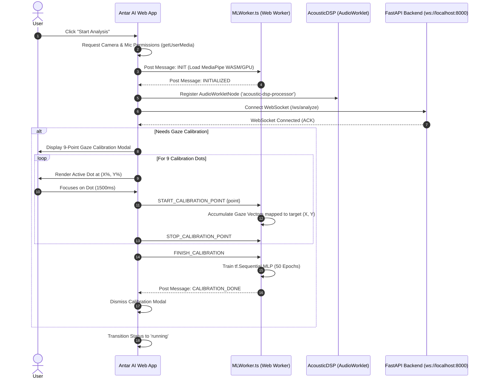
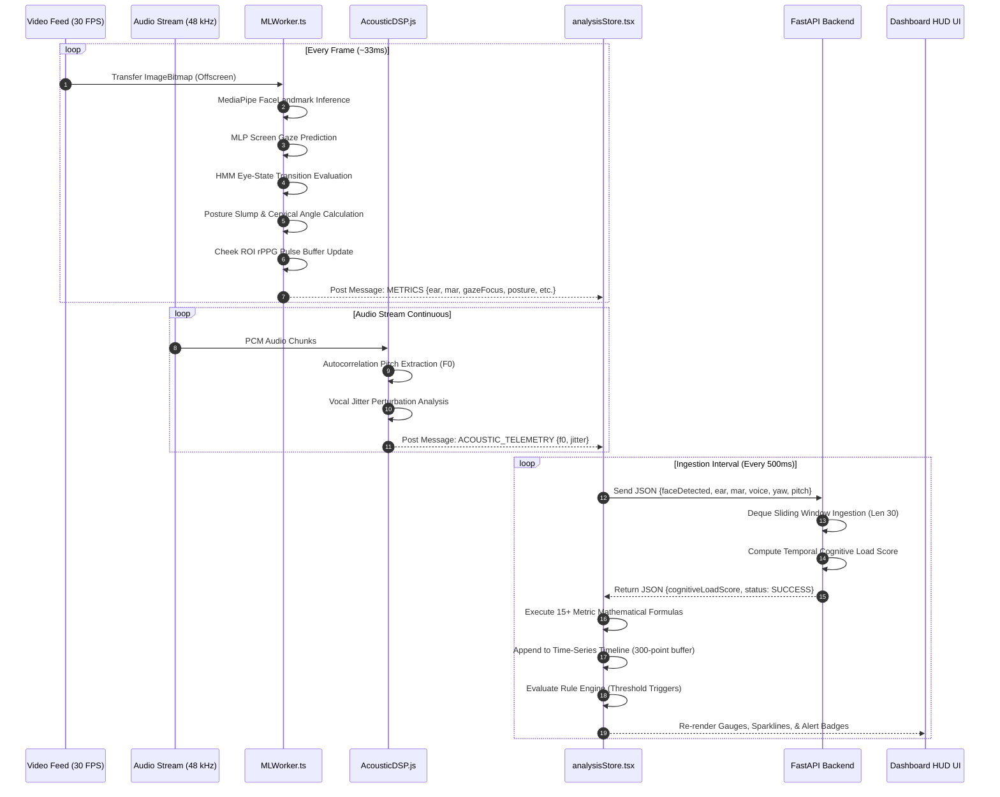

# Product Requirements Document (PRD)
## Antar AI (v3) — Real-Time Multimodal Cognitive & Affective Computing Platform

---

### Document Control & Metadata
* **Product Name**: Antar AI
* **Version**: 3.0.0 (Enterprise Client-Side ML Architecture)
* **Author**: Engineering & Product Architecture Team
* **Status**: Approved / In Active Implementation
* **Target Audience**: Core Engineers, ML Practitioners, UX/UI Designers, Enterprise Customers, Academic Researchers
* **Last Updated**: November 2026

---

## 1. Executive Summary & Vision

### 1.1 Problem Statement
Digital knowledge workers, remote students, and enterprise teams spend 6 to 10 hours daily interacting with screens during video conferences, asynchronous deep work, and digital learning. However, modern digital workspaces are fundamentally blind to human cognitive state. They cannot detect:
1. **Silent cognitive overload** and mental exhaustion leading to burnout.
2. **Inattentive presence** (eyes on screen, but attention disengaged or tab in background).
3. **Ergonomic degradation** (progressive forward head slump and cervical spine strain).
4. **Vocal and emotional stress** (acoustic jitter, pitch shifts, facial tension).
5. **Microsleeps and fatigue hazards** during high-stakes sessions.

Existing solutions rely on invasive employee surveillance (keystroke logging, screen capture) or post-hoc self-reported surveys. Both fail to provide non-invasive, real-time, privacy-preserving cognitive feedback.

### 1.2 Product Vision & Value Proposition
**Antar AI** is a real-time, edge-native, multimodal cognitive and affective computing platform. It continuously quantifies and coaches human attention, mental fatigue, cognitive load, flow state, and ergonomic health during digital sessions—without streaming raw video or audio to external servers.

Antar AI delivers:
* **Zero-Cloud Video Privacy**: 100% of computer vision and acoustic digital signal processing (DSP) executes locally in the client browser using Web Workers, Web Audio Worklets, WebAssembly (WASM), and WebGPU.
* **Peer-Reviewed Computational Biology**: Gaze regression, Eye Aspect Ratio (EAR), Mouth Aspect Ratio (MAR), Facial Action Coding System (FACS), and Autocorrelation pitch extraction replace heuristic approximations with mathematically rigorous metrics.
* **Actionable Cognitive Closed-Loop**: Real-time telemetry drives interactive dashboards, dynamic micro-break interventions, session replay scrubs, and a personalized **Digital Twin** that models circadian productivity cycles.

---

## 2. User Personas & Core Use Cases

| Persona | Primary Needs & Pain Points | Key Antar AI Value Drivers |
| :--- | :--- | :--- |
| **Deep Knowledge Worker (Dev / Analyst / Researcher)** | Context switching, mental exhaustion, unnoticed posture degradation during multi-hour focus sessions. | Real-time Deep Focus & Flow State scoring, cervical slump alerts, automated Pomodoro/break recommendation when Cognitive Fatigue Index exceeds thresholds. |
| **Remote Student / Online Learner** | Attention drift during asynchronous lectures; lack of retention feedback; passive video consumption. | Engagement DNA archetype profiling, Learning Retention Prediction score, Attention Replay timeline scrubbing to review confusing lecture segments. |
| **Enterprise Presenter / Team Lead** | Cannot gauge audience engagement or understand meeting dynamics over Zoom/Teams/Meet. | Aggregate Engagement Probability, Vocal Interaction activity metric, real-time feedback on pacing and emotional stability. |
| **High-Stakes Examination / Proctored Assessment** | Need objective, non-invasive verification of candidate focus, presence, and absence of secondary device distraction. | 9-point calibrated Screen Gaze tracking, Face Framing confidence, Tab Visibility monitoring, and Eye State HMM Microsleep tracking. |

---

## 3. High-Level System Architecture

Antar AI is built as a hybrid edge-first client application with an optional high-performance WebSocket inference backend.

```
+---------------------------------------------------------------------------------------------------------+
|                                         ANTAR AI v3 ARCHITECTURE                                        |
+---------------------------------------------------------------------------------------------------------+
|  HARDWARE CAPTURE LAYER                                                                                 |
|  [ Web Camera (720p/1080p @ 30 FPS) ]               [ Studio / Integrated Microphone (48 kHz) ]         |
+---------------------------------------------------------------------------------------------------------+
                                          |                                           |
                                  (ImageBitmap)                               (AudioStreamTrack)
                                          v                                           v
+---------------------------------------------------------------------------------------------------------+
|  CLIENT MULTITHREADED PROCESSING LAYER (Zero Main-Thread Blocking)                                      |
|                                                                                                         |
|  +-----------------------------------------------------+  +-------------------------------------------+ |
|  | Web Worker: MLWorker.ts                             |  | AudioWorklet: AcousticDSP.js              | |
|  |                                                     |  |                                           | |
|  | * MediaPipe FaceLandmarker (478 3D mesh points)     |  | * Autocorrelation Pitch Detector (F0)     | |
|  | * 52 FACS Blendshapes Engine                        |  | * Short-Term Acoustic Jitter Analysis     | |
|  | * TensorFlow.js 2D Gaze Regressor (MLP)             |  | * Time-Domain RMS Vocal Energy            | |
|  | * Hidden Markov Model (HMM) Eye-State Engine        |  +-------------------------------------------+ |
|  | * Posture Vector & Cervical Angle Analysis          |                        |                       |
|  | * Remote Photoplethysmography (rPPG) ROI Buffer     |                        |                       |
|  +-----------------------------------------------------+                        |                       |
+---------------------------------------------------------------------------------------------------------+
                            |                                                     |
                            +--------------------------+--------------------------+
                                                       v
+---------------------------------------------------------------------------------------------------------+
|  REACTIVE STORE & MATHEMATICAL FUSION LAYER (analysisStore.tsx & appStore.ts)                           |
|                                                                                                         |
|  * 15+ Deterministic Mathematical Formulations (Attention, Fatigue, Boredom, Flow, Retention)          |
|  * 1-Second Time-Series Resampling & Sliding Window Cache (300 Samples)                                 |
|  * Real-Time Rule Engine & Dynamic Actionable Insight Generation                                        |
+---------------------------------------------------------------------------------------------------------+
               |                                                                    ^
       (Telemetry JSON)                                                             |
               v                                                                    |
+-----------------------------------------+           +-------------------------------------------------+
| LOCAL WEBSOCKET BACKEND (main.py)       |           | USER WORKSPACE INTERFACE (React 19 + Tailwind)  |
| * FastAPI Async Endpoint                |           | * Command Dashboard & Live HUD Overlays         |
| * 30-Frame Multimodal Temporal Deque    |           | * Attention Replay & Visual Gaze Heatmaps       |
| * Heuristic & ML Cognitive Classifier   |           | * Cognitive Load & Ergonomic Stress Monitors    |
| * Extensible for PyTorch GRU / ONNX     |           | * Digital Twin Circadian & Behavioral Modeler   |
+-----------------------------------------+           | * Interactive Context-Aware AI Copilot          |
                                                      +-------------------------------------------------+
```

### 3.1 Technology Stack Matrix

| Layer | Technology | Version | Purpose & Architectural Justification |
| :--- | :--- | :--- | :--- |
| **Core UI Framework** | React (TypeScript) | 19.2.6 | Functional declarative rendering, strict concurrent mode stability. |
| **Bundler & Build Tool** | Vite | 7.3.2 | Sub-second HMR, optimized multi-worker bundling with ESM support. |
| **Styling & Design System** | Tailwind CSS v4 | 4.1.17 | CSS-variable native design tokens, frosted-glass morphic UI. |
| **Motion & Animation** | Framer Motion | 12.40.0 | High-performance 60fps spring transitions and HUD physics. |
| **Telemetry Charting** | Recharts | 3.8.1 | Responsive SVG time-series, radar, and gauge visualizations. |
| **Client Vision ML** | `@mediapipe/tasks-vision` | 1.0.1 | 478 3D face mesh vertices + 52 FACS blendshapes via WebGL/GPU. |
| **Client Neural Regression** | `@tensorflow/tfjs` | 4.22.0 | Multi-Layer Perceptron for 2D screen gaze calibration and inference. |
| **Acoustic Signal Processing** | Web Audio API / AudioWorklet | Standard W3C | Low-latency off-main-thread PCM processing, autocorrelation DSP. |
| **State Management** | React Context + Custom Reducer | Native | Zero-dependency reactive state with fine-grained memoization. |
| **Backend Framework** | Python FastAPI / Uvicorn | 0.110+ | Asynchronous bi-directional WebSocket server for temporal fusion. |
| **Backend DSP / ML** | NumPy | 1.26+ | Fast vector operations on streaming biometric windows. |

---

## 4. Comprehensive Feature Specifications

### Feature 1: Live Hardware Capture & Calibration HUD (`WebcamAnalysis.tsx` & `GazeCalibration.tsx`)
* **Hardware Ingestion**:
  * Dual-stream capture via `navigator.mediaDevices.getUserMedia`:
    * Video: Facing user, 960x540 ideal resolution, 30 FPS.
    * Audio: 48 kHz, active echo cancellation, noise suppression, and auto gain control.
  * Live video mirrored in an expandable, draggable picture-in-picture (PiP) or inline canvas HUD.
* **Dynamic Visual Overlays**:
  * Real-time bounding box (`FaceBox`) rendered around detected user face with confidence-coded border states (Green = Calibrated & Focused; Amber = Head Misaligned; Red = Face Lost).
  * Video framing score based on facial center $(x, y)$ and surface area ratio relative to viewport.
* **9-Point Spatial Gaze Calibration Protocol**:
  * An interactive modal overlay presenting 9 sequential calibration dots in a $3 \times 3$ grid ($(10\%, 10\%)$ to $(90\%, 90\%)$).
  * 1000ms transition interval + 1500ms focused gaze sampling per dot.
  * Extracts 10-dimensional feature vectors per frame and trains a client-side TensorFlow.js neural network in under 2 seconds.

### Feature 2: High-Performance Multi-Threaded Vision & Audio ML Engine
* **Web Worker Offloading (`MLWorker.ts`)**:
  * Main UI thread captures video frames as `ImageBitmap` and transfers ownership zero-copy to the Web Worker.
  * MediaPipe FaceLandmarker executes detection using the GPU delegate.
* **Screen Gaze Regressor**:
  * 10-input neural network predicting normalized monitor screen coordinates $(X_{screen}, Y_{screen})$.
* **Eye State Hidden Markov Model (HMM)**:
  * Classifies states dynamically: `AWAKE`, `BLINKING`, `MICROSLEEP`.
  * Triggers critical hazard events when eye closure exceeds $500\text{ms}$ (15 consecutive frames at 30fps).
* **FACS Cognitive State Evaluation**:
  * Combines facial action units:
    * *Frustration*: Brow Down ($AU4$), Eye Squint ($AU7$), Nose Sneer ($AU9$).
    * *Boredom*: Jaw Open ($AU26/27$) combined with high gaze variance.
    * *Flow State*: Balanced Eye Wide ($AU5$) combined with minimal gaze variance.
* **Posture & Ergonomic Telemetry**:
  * Analyzes Cervical Angle ($\theta_{cervical}$) via nose-to-ear projection vector.
  * Calculates Slump Ratio ($R_{slump}$) against user's calibrated baseline face height. Detects forward head posture and slouching.
* **Remote Photoplethysmography (rPPG) Pulse Buffer**:
  * Samples 10x10 skin pixel patch from Left Cheek Landmark 117.
  * Buffers RGB luminance values across a 300-frame sliding window (10 seconds) for vascular pulse extraction.
* **Audio DSP Worklet (`AcousticDSP.js`)**:
  * Custom `AudioWorkletProcessor` running directly in the browser audio thread.
  * Implements time-domain autocorrelation to extract Fundamental Frequency ($F_0$) across the human vocal range (120 Hz to 600 Hz).
  * Computes short-term vocal jitter (cycle-to-cycle frequency perturbation) as a direct correlate of vocal fatigue and physiological stress.

### Feature 3: Command Center Dashboard (`DashboardPage.tsx`)
* **Primary HUD Gauges**:
  * Large, responsive SVG radial gauge displaying real-time **Engagement Probability** (0–100%).
  * Subsidiary gauges for **Attention Confidence**, **Deep Focus**, and **Cognitive Fatigue**.
* **Live Telemetry Strip**:
  * Real-time metrics grid displaying Face Presence, Framing Score, Voice Decibels, Blink Rate, Cervical Slump, and Tab Visibility.
* **Temporal Sparkline & Trend Indicators**:
  * Dynamic momentum indicators ($\Delta Engagement$) illustrating short-term acceleration or decay in user attention.
* **Session Lifecycle Controls**:
  * Single-click `Start Analysis`, `Pause`, `Stop Session`, and `Calibrate Gaze` controls.
  * Session timer with persistent state across view navigation.

### Feature 4: Temporal Analytics & Correlation Engine (`AnalyticsPage.tsx`)
* **Synchronized Multi-Line Time-Series Chart**:
  * Real-time Recharts visualization tracking Attention, Focus, Voice Energy, Fatigue, and Boredom on a synchronized timeline.
* **Cross-Metric Correlation Matrix**:
  * Identifies causal relationships between vocal interaction and focus peaks, or between head slump and boredom escalation.
* **Session Comparison Hub**:
  * Aggregates completed sessions with comparative statistics: duration, average engagement, peak deep focus duration, and fatigue build-up rate.

### Feature 5: Frame-Accurate Attention Replay (`AttentionReplayPage.tsx`)
* **Interactive Timeline Scrubber**:
  * Minute-by-minute playback controller with Play, Pause, Step Forward (5s), and Step Backward (5s).
* **Simulated Focus Overlays**:
  * Virtualized gaze target tracker overlaying the timeline, illustrating where visual focus was concentrated during key session segments.
* **Anomaly & Event Bookmarks**:
  * Automated bookmarking of critical session moments:
    * Sudden Attention Drops ($> 30\%$ drop in $< 10$ seconds).
    * Microsleep Incidents ($\ge 500\text{ms}$ eye closure).
    * Vocal Peaks & Collaborative Exchanges.

### Feature 6: Digital Twin & Circadian Profiling (`DigitalTwinPage.tsx`)
* **Behavioral Modeling**:
  * Long-term algorithmic representation of user-specific cognitive stamina, recovery speed, and distraction resistance.
* **Radar Chart of Cognitive Dimensions**:
  * 6-axis polar radar: Attention Span, Stress Recovery, Ergonomic Discipline, Vocal Dynamics, Deep Flow Propensity, and Visual Stability.
* **Predictive Circadian Curve**:
  * Maps chronological hours of the day (06:00 to 22:00) against empirical user performance to identify optimal personal focus windows (Golden Hours).

### Feature 7: Engagement DNA Profiling (`EngagementDNAPage.tsx`)
* **Cognitive Archetype Classification**:
  * Dynamically classifies users into archetypes:
    * *The Hyper-Focused Sprinter*: High peak focus, rapid fatigue onset.
    * *The Collaborative Synthesizer*: High voice interaction, high emotional stability.
    * *The Steady Marathoner*: Moderate focus, zero slumping, exceptional stamina.
* **Attention Half-Life Decay Curve**:
  * Calculates the exact mathematical decay rate ($\lambda$) of user attention without stimulation.
* **Multimodal Ratio Decompositions**:
  * Pie and stacked bar decompositions showing the exact percentage contributions of Visual, Acoustic, and Postural factors to the user's score.

### Feature 8: Cognitive Load & Ergonomic Health (`CognitiveLoadPage.tsx`)
* **Cognitive Strain Diagnostics**:
  * Real-time monitoring of mental overload vs. under-stimulation (boredom).
* **Ergonomic Strain Warning System**:
  * Tracks cumulative minutes spent in cervical slump ($\theta_{cervical} < 45^\circ$ or $R_{slump} < 0.82$).
* **Closed-Loop Micro-Break Engine**:
  * Proactive alerts recommending 2-minute eye rest (20-20-20 rule) or physical posture reset when fatigue index crosses 70%.

### Feature 9: Executive Reports & Data Export (`ReportsPage.tsx`)
* **Automated Session Performance Scorecard**:
  * Letter grading (A+ to F) computed via weighted multi-factor scoring.
* **Executive Summary Generation**:
  * Key takeaways highlighting focus milestones, longest continuous flow state block, and ergonomic risk flags.
* **Data Portability**:
  * Export complete session datasets in raw JSON or tabular CSV for external enterprise analytics or academic research.

### Feature 10: Context-Aware AI Copilot (`AIChatbot.tsx`)
* **Integrated Assistant Drawer**:
  * Slide-over glassmorphic chat interface powered by the local session context.
* **Dynamic Natural Language Telemetry Queries**:
  * Instant answers to questions such as:
    * *"How is my focus trending compared to 10 minutes ago?"*
    * *"Why did my engagement score drop just now?"*
    * *"What are my top ergonomic recommendations for this session?"*
  * Grounded directly in live `metrics`, `insights`, and `completedSessions` without hallucination.

### Feature 11: Enterprise Administration & Privacy Governance (`AdminPage.tsx` & `SettingsPage.tsx`)
* **Inference Hardware Delegation**:
  * User-selectable execution targets: WebGPU (Fastest), WebGL, or WASM CPU Fallback.
* **Privacy & Sensor Gates**:
  * Granular toggles to enable/disable camera, microphone, or backend WebSocket communication.
* **Enterprise Role-Based Access Control (RBAC)**:
  * Admin oversight for team-wide aggregate engagement analytics while cryptographically isolating individual raw biometric feeds.

---

## 5. Mathematical & Algorithmic Formulation

Every metric in Antar AI is strictly calculated from real-time physical signals according to the following deterministic formulas.

### 5.1 Raw Sensor Indices

#### Video Framing Score ($Framing$)
$$Framing = \text{clamp}\left(0.40 \cdot S_x + 0.30 \cdot S_y + 0.30 \cdot S_{area}, 0, 100\right)$$
Where:
* $S_x = 100 - \left| \frac{x_{center}}{W_{video}} - 0.50 \right| \cdot 200$
* $S_y = 100 - \left| \frac{y_{center}}{H_{video}} - 0.45 \right| \cdot 180$
* $S_{area} = 100 - \left| \frac{\text{Area}_{face}}{\text{Area}_{video}} - 0.18 \right| \cdot 260$

#### Voice Energy Score ($Voice$)
$$Voice = \text{clamp}\left(\text{RMS} \cdot 320, 0, 100\right)$$
Where $\text{RMS} = \sqrt{\frac{1}{N} \sum_{i=1}^{N} \left(\frac{s_i - 128}{128}\right)^2}$ across a 1024-sample byte time-domain audio buffer.

---

### 5.2 Computer Vision Biometric Ratios

#### Eye Aspect Ratio ($EAR$)
For left and right eye landmark sets $\{p_1, \dots, p_6\}$:
$$EAR = \frac{\|p_2 - p_6\|_2 + \|p_3 - p_5\|_2}{2 \cdot \|p_1 - p_4\|_2}$$
$$EAR_{combined} = \frac{EAR_{left} + EAR_{right}}{2}$$

#### Mouth Aspect Ratio ($MAR$)
For mouth landmarks $p_{top} (13), p_{bottom} (14), p_{left} (78), p_{right} (308)$:
$$MAR = \frac{\|p_{top} - p_{bottom}\|_2}{\|p_{left} - p_{right}\|_2}$$

#### Blink Stability Score ($BlinkStability$)
$$BlinkStability = \text{clamp}\left(100 - \left| \frac{EAR - 0.25}{0.25} \right| \cdot 50, 0, 100\right)$$

---

### 5.3 2D Screen-Gaze Neural Regression

#### Gaze Vector Formulation ($G_{vector}$)
$$G_{vector} = [\Delta x_L, \Delta y_L, \Delta z_L, \Delta x_R, \Delta y_R, \Delta z_R, \text{pitch}, \text{yaw}, \text{roll}, \text{aspect\_ratio}] \in \mathbb{R}^{10}$$
Where $\Delta x, \Delta y, \Delta z$ are normalized vectors between pupil centers ($468, 473$) and inner eye canthi ($362, 133$).

#### MLP Regression Architecture
* **Input Layer**: 10 units
* **Hidden Layer 1**: 16 units, ReLU activation
* **Hidden Layer 2**: 8 units, ReLU activation
* **Output Layer**: 2 units ($X_{screen}, Y_{screen} \in [0, 1]$), Linear activation
* **Loss Function**: Mean Squared Error ($\text{MSE}$) optimized via Adam ($\alpha = 0.01$).

#### Gaze Focus Score ($GazeFocus$)
$$GazeFocus = \text{clamp}\left(100 - \left(|X_{screen} - 0.5| + |Y_{screen} - 0.5|\right) \cdot 100, 0, 100\right)$$

---

### 5.4 Ergonomic Posture & Alignment

#### Cervical Angle ($\theta_{cervical}$)
Given nose coordinate $(x_n, y_n)$ and ear midpoint $(x_e, y_e)$:
$$\theta_{cervical} = \left| \text{atan2}(y_n - y_e, x_n - x_e) \cdot \frac{180}{\pi} \right|$$

#### Slump Ratio ($R_{slump}$) & Forward Slump Condition
$$R_{slump} = \frac{H_{current\_face}}{H_{baseline\_face}}$$
$$\text{isSlumping} = (R_{slump} < 0.82) \lor (\theta_{cervical} < 45^\circ)$$

#### Head Alignment Score ($HeadAlignment$)
$$HeadAlignment = \text{clamp}\left(100 - \frac{|\text{yaw}| + |\text{pitch}|}{45} \cdot 100, 0, 100\right)$$

#### Posture Stability Score ($PostureStability$)
$$PostureStability = \text{clamp}\left(100 - |HeadAlignment_t - HeadAlignment_{t-1}| \cdot 2.5, 0, 100\right)$$

---

### 5.5 Acoustic Digital Signal Processing

#### Autocorrelation Pitch Detection ($F_0$)
For discrete audio buffer $x[n]$ of length $N = 2048$:
$$R_{xx}[k] = \sum_{n=0}^{N - k - 1} x[n] \cdot x[n + k]$$
$$k^* = \arg\max_{k \in [80, 400]} R_{xx}[k] \implies F_0 = \frac{f_s}{k^*} \quad (f_s = 48000 \text{ Hz})$$

#### Vocal Jitter ($Jitter$)
Given fundamental period $T_0 = \frac{f_s}{F_0}$ and consecutive peak amplitudes $P_i, P_{i+1}$:
$$Jitter = \frac{1}{M \cdot T_0} \sum_{i=1}^{M} |P_i - P_{i+1}|$$

---

### 5.6 High-Level Cognitive & Affective Indices

#### Facial Engagement Score ($FacialEngagement$)
$$FacialEngagement = \text{clamp}\left(0.40 \cdot \text{Smile} + 0.30 \cdot \text{EyeOpenness} + 0.30 \cdot \text{ExpressionActivity}, 0, 100\right)$$

#### Interaction Activity Score ($InteractionScore$)
$$InteractionScore = \text{clamp}(Voice \cdot 1.20, 0, 100)$$

#### Cognitive Fatigue Index ($CognitiveFatigue$)
When backend inference is connected:
$$CognitiveFatigue = \text{clamp}(Score_{backend} \cdot 100, 0, 100)$$
Client-side fallback:
$$CognitiveFatigue = \text{clamp}\left(0.40 \cdot (100 - BlinkStability) + 0.20 \cdot YawnProb + 0.10 \cdot HeadDroop, 0, 100\right)$$
Where $YawnProb = 80 \text{ if } MAR > 0.40 \text{ else } 0$.

#### Attention Confidence Score ($AttentionConfidence$)
$$AttentionConfidence = \text{clamp}\left(0.35 \cdot GazeFocus + 0.20 \cdot HeadAlignment + 0.15 \cdot BlinkStability + 0.15 \cdot PostureStability + 0.15 \cdot InteractionScore, 0, 100\right)$$

#### Emotional Stability Index ($EmotionalStability$)
$$EmotionalStability = \text{clamp}\left(100 - |FacialEngagement_t - FacialEngagement_{t-1}| \cdot 3.0, 0, 100\right)$$

#### Deep Focus Detection Score ($DeepFocus$)
$$DeepFocus = \text{clamp}\left(0.50 \cdot GazeFocus + 0.30 \cdot PostureStability + 0.20 \cdot BlinkStability, 0, 100\right)$$

#### Overall Engagement Probability ($Engagement$)
$$Engagement = \text{clamp}\left(\frac{AttentionConfidence + FacialEngagement + InteractionScore - CognitiveFatigue}{2.20}, 0, 100\right)$$

#### Engagement Momentum ($\Delta Engagement$)
$$\Delta Engagement = Engagement_t - Engagement_{t-1}$$

#### Learning Retention Prediction ($LearningRetention$)
$$LearningRetention = \text{clamp}\left(0.40 \cdot AttentionConfidence + 0.30 \cdot EmotionalStability + 0.30 \cdot InteractionScore, 0, 100\right)$$

#### Boredom Detection Index ($BoredomIndex$)
$$BoredomIndex = \text{clamp}\left(0.30 \cdot (100 - GazeFocus) + 0.20 \cdot (100 - PostureStability) + 0.20 \cdot YawnProb + 0.15 \cdot (100 - FacialEngagement) + 0.15 \cdot (100 - InteractionScore), 0, 100\right)$$

#### System Signal Confidence ($Confidence$)
$$Confidence = \text{clamp}\left((DetectorReady ? 35 : 10) + (FaceDetected ? 35 : 0) + (AudioActive ? 20 : 0) + (TabVisible ? 10 : 0), 0, 100\right)$$

---

## 6. End-to-End System Workflows

### 6.1 Calibration & Session Launch Workflow



### 6.2 Real-Time Ingestion & Closed-Loop Feedback Workflow



---

## 7. Data Models & API Contracts

### 7.1 Client-Side TypeScript Interfaces (`analysisStore.tsx`)

```typescript
export interface SensorSample {
  faceDetected: boolean | null;
  faceBox?: FaceBox;
  videoWidth?: number;
  videoHeight?: number;
  audioEnergy: number;
  tabVisible: boolean;
  detectorAvailable: boolean;
  capturedAt: number;
  ear?: number;
  mar?: number;
  gazeFocus?: number;
  backendCognitiveLoad?: number;
  rppgSignal?: { r: number; g: number; b: number }[];
  eyeState?: 'AWAKE' | 'BLINKING' | 'MICROSLEEP';
  facsFrustration?: number;
  facsBoredom?: number;
  facsFlowState?: number;
  postureCervicalAngle?: number;
  postureSlumpRatio?: number;
  postureIsSlumping?: boolean;
  vocalJitter?: number;
  fundamentalFrequency?: number;
}

export interface LiveMetrics {
  // Raw Sensory Data
  facePresence: number;
  framing: number;
  voice: number;

  // Foundational Biological Scores
  gazeFocus: number;
  blinkStability: number;
  headAlignment: number;
  facialEngagement: number;
  postureStability: number;
  interactionScore: number;

  // High-Level Cognitive & Affective Indices
  attentionConfidence: number;
  cognitiveFatigueIndex: number;
  emotionalStability: number;
  deepFocus: number;
  boredomIndex: number;

  // Core Outcomes
  engagement: number;
  engagementMomentum: number;
  learningRetentionPrediction: number;

  // System Health & Telemetry
  confidence: number;
  detectorAvailable: boolean;
  sampleCount: number;
  capturedAt: number | null;
  tabVisible: boolean;
}

export interface TimeSeriesPoint {
  time: string;
  engagement: number;
  attentionConfidence: number;
  deepFocus: number;
  interactionScore: number;
  cognitiveFatigueIndex: number;
  boredomIndex: number;
}
```

### 7.2 WebSocket Contract (`/ws/analyze`)

#### Client Payload (Outbound to Server every 500ms):
```json
{
  "faceDetected": true,
  "ear": 0.284,
  "mar": 0.082,
  "voice": 24.5,
  "yaw": 0.02,
  "pitch": -0.05,
  "cervicalAngle": 52.4,
  "vocalJitter": 0.018
}
```

#### Server Response (Inbound to Client):
```json
{
  "cognitiveLoadScore": 0.64,
  "status": "SUCCESS"
}
```
*(In case face is lost: `{"cognitiveLoadScore": 0.0, "status": "NO_FACE"}`)*

---

## 8. Non-Functional Requirements & Performance Budgets

| Requirement Category | Metric / Target | Implementation Strategy & Validation |
| :--- | :--- | :--- |
| **Frame Latency (Vision)** | $\le 33.3\text{ ms}$ per frame ($30\text{ FPS}$) | OffscreenCanvas + ImageBitmap zero-copy transfer to `MLWorker.ts`; WebGPU/WebGL hardware acceleration. |
| **Audio Processing Latency** | $\le 15\text{ ms}$ | Native `AudioWorkletProcessor` executing on dedicated browser audio thread without GC pauses. |
| **CPU Overhead** | $\le 15\%$ average utilization on modern quad-core laptops | Multithreaded worker partitioning; UI main thread restricted to 60fps DOM/SVG rendering. |
| **Memory Footprint** | $\le 250\text{ MB}$ total browser tab memory | Explicit disposal of WebGL/TensorFlow tensors via `tf.tidy()` and `tensor.dispose()`; capped time-series ring buffers (300 points). |
| **Privacy & Security** | 0 bytes of raw audio/video transmitted off-device | Strict local sandbox; only anonymous scalar feature vectors sent over local `ws://localhost:8000`. No camera feeds leave memory. |
| **Reliability & Degradation** | 100% uptime with graceful fallback | If WebGPU unavailable $\rightarrow$ WebGL $\rightarrow$ WASM CPU $\rightarrow$ Deterministic heuristic fallback in `analysisStore.tsx`. |
| **Cross-Platform Compatibility** | Tier 1: Chrome 115+, Edge 115+, Brave; Tier 2: Firefox 120+, Safari 17+ | Standards-compliant Web Audio API, Web Workers, and WebAssembly. |

---

## 9. Implementation Roadmap & Milestones

```
+---------------------------------------------------------------------------------------------------------+
|                                    ANTAR AI RELEASE ROADMAP                                             |
+---------------------------------------------------------------------------------------------------------+
| MILESTONE 1 (Complete)       | MILESTONE 2 (Complete)       | MILESTONE 3 (Current)    | MILESTONE 4    |
| * UI/UX Dashboard Prototype  | * MediaPipe FaceMesh Worker  | * TensorFlow.js Gaze MLP | * ONNX WebGPU  |
| * Basic Web Audio Analyser   | * AudioWorklet DSP (F0)      | * 9-Point Calibration HUD| * PyTorch GRU  |
| * Heuristic Simulated State  | * HMM Eye-State & Microsleep | * Posture Slump Engine   | * Zoom/Teams   |
| * Initial Page Architecture  | * FastAPI WebSocket Bridge   | * Dynamic Insight Engine |   Plugin SDK   |
+---------------------------------------------------------------------------------------------------------+
```

### Phase 1: Foundational Shell & UI (v1.0) — *Delivered*
* React 19 + Tailwind v4 + Vite architecture established.
* Full page ecosystem created (Dashboard, Analytics, Digital Twin, Replay, DNA, Cognitive Load, Reports, Admin, Chatbot).
* Experimental `window.FaceDetector` and `AnalyserNode` volume integration.

### Phase 2: Multithreaded Engine & DSP Architecture (v2.0) — *Delivered*
* Web Worker infrastructure (`MLWorker.ts`) with MediaPipe Tasks Vision.
* AudioWorklet Autocorrelation Pitch Detector (`AcousticDSP.js`) and short-term vocal jitter analysis.
* FastAPI local WebSocket server for sliding-window temporal inference.

### Phase 3: True Client-Side Machine Learning & Calibration (v3.0) — *Delivered*
* TensorFlow.js 2D screen gaze regression replacing randomized focus models.
* Interactive 9-point spatial calibration screen (`GazeCalibration.tsx`).
* Hidden Markov Model (HMM) Eye-State Engine (Awake, Blink, Microsleep).
* FACS emotion extraction (Frustration, Boredom, Flow State).
* Ergonomic cervical spine angle and forward slump detection.
* Cheek ROI rPPG heart rate buffer collection.

### Phase 4: Enterprise Integrations & Deep Neural Inference (v3.5+) — *Upcoming*
* Client-side ONNX Runtime Web with WebGPU for continuous facial emotion classification.
* Integration of pre-trained PyTorch GRU temporal model on FastAPI backend.
* Chrome Extension / Electron wrapper for universal desktop overlay across Zoom, Microsoft Teams, and Google Meet.
* Enterprise Single Sign-On (SSO) and SOC2-compliant anonymized compliance reports.

---

## 10. Verification, Acceptance Criteria & Testing Protocol

| Test Scenario | Verification Procedure | Expected Outcome / Acceptance Gate |
| :--- | :--- | :--- |
| **Gaze Calibration Accuracy** | User completes 9-point calibration; user focuses sequentially on 4 screen corners and center. | Predicted screen coordinates match target quadrants with $< 15\%$ root mean square error (RMSE). |
| **Microsleep Hazard Detection** | User closes eyes continuously for $> 500\text{ms}$ ($> 15$ frames at 30 FPS). | `EyeStateHMM` transitions to `MICROSLEEP`; HUD displays immediate high-priority fatigue alert. |
| **Ergonomic Slump Alerting** | User lowers head to cervical angle $< 45^\circ$ or slumps forward ($R_{slump} < 0.82$). | `postureIsSlumping` evaluates to `true`; posture stability score drops; dashboard flags ergonomic risk. |
| **Vocal Activity Tracking** | User speaks intermittently during a 60-second period. | `AcousticDSP` detects $F_0 \in [120, 600]\text{Hz}$; `InteractionScore` dynamically scales with speech volume and frequency. |
| **Tab Inactivity Detection** | User switches to a different browser tab or minimizes window. | `tabVisible` evaluates to `false`; `SignalConfidence` penalizes score; dashboard flags tab distraction. |
| **Camera Disconnect Recovery** | User revokes webcam permission or disconnects USB camera mid-session. | `WebcamAnalysis.tsx` cleanly catches exception, terminates worker frame loop, and gracefully resets UI to idle without crash. |

---

## 11. Appendix: Complete Directory & File Manifest

```
Antar-AI-v3-main/
├── backend/
│   ├── main.py                     # FastAPI WebSocket & temporal cognitive load inference server
│   └── requirements.txt            # Python dependencies (fastapi, uvicorn, numpy)
├── public/
│   ├── processors/
│   │   └── AcousticDSP.js          # AudioWorkletProcessor: Autocorrelation F0 pitch & vocal jitter DSP
│   └── workers/
│       └── MLWorker.ts             # Compiled static worker assets
├── src/
│   ├── components/
│   │   ├── chat/
│   │   │   └── AIChatbot.tsx       # Local context-aware AI assistant drawer
│   │   ├── layout/
│   │   │   ├── Sidebar.tsx         # Navigation sidebar with route indicators
│   │   │   └── TopBar.tsx          # Status bar, session timer, and quick controls
│   │   ├── ui/
│   │   │   ├── GaugeChart.tsx      # SVG radial indicator for engagement probability
│   │   │   ├── GlassCard.tsx       # Frosted-glass container component
│   │   │   ├── HeatmapChart.tsx    # Visual attention density matrix
│   │   │   ├── ParticleField.tsx   # Ambient background particles
│   │   │   └── StatCard.tsx        # KPI metric card with trend delta
│   │   └── webcam/
│   │       ├── GazeCalibration.tsx # 9-point interactive calibration overlay
│   │       └── WebcamAnalysis.tsx  # Video capture, face bounding box HUD, and sensor ingestion loop
│   ├── data/
│   │   └── appContent.ts           # Marketing copy, feature manifests, and plan tiers
│   ├── hooks/
│   │   └── useLiveSensor.ts        # Hook managing MLWorker and AudioWorklet lifecycles
│   ├── pages/
│   │   ├── AdminPage.tsx           # Enterprise administration & device settings
│   │   ├── AnalyticsPage.tsx       # Multimodal time-series & correlation charts
│   │   ├── AttentionReplayPage.tsx # Frame-accurate timeline scrubber & simulation overlay
│   │   ├── AuthPage.tsx            # Login, registration, and security credentials
│   │   ├── CognitiveLoadPage.tsx   # Fatigue, mental strain, and micro-break recommendations
│   │   ├── DashboardPage.tsx       # Command center with primary HUD and live stream
│   │   ├── DigitalTwinPage.tsx     # Long-term behavioral model & circadian analysis
│   │   ├── EngagementDNAPage.tsx   # Cognitive archetype & multimodal ratio breakdown
│   │   ├── HomePage.tsx            # Marketing landing page & live interactive demo
│   │   ├── ProfilePage.tsx         # User baseline settings and personalized targets
│   │   ├── ReportsPage.tsx         # Session performance scorecard & CSV/JSON export
│   │   └── SettingsPage.tsx        # Hardware configuration & inference engine controls
│   ├── services/
│   │   └── LiveMLEngine.ts         # Direct MediaPipe initialization and EAR/MAR math helpers
│   ├── store/
│   │   ├── analysisStore.tsx       # Core reactive store: 15+ mathematical formulas & time-series
│   │   ├── appStore.ts             # Global UI state (sidebar, chat drawer, active routes)
│   │   └── profileStore.tsx        # User profile, baseline parameters, and coaching goals
│   ├── utils/
│   │   └── cn.ts                   # Class name merger (clsx + tailwind-merge)
│   ├── workers/
│   │   └── MLWorker.ts             # Dedicated Web Worker: MediaPipe, TF.js Gaze MLP, HMM, Posture, rPPG
│   ├── App.tsx                     # React Router 7 route provider
│   ├── index.css                   # Tailwind CSS v4 design tokens and utilities
│   └── main.tsx                    # React DOM entrypoint
├── documentation.md                # High-level architecture summary
├── package.json                    # Project dependencies and build scripts
├── prd.md                          # This document
├── tailwind.config.js              # Tailwind styling configuration
├── tsconfig.json                   # TypeScript compiler options
└── vite.config.ts                  # Vite build and worker bundling configuration
```
